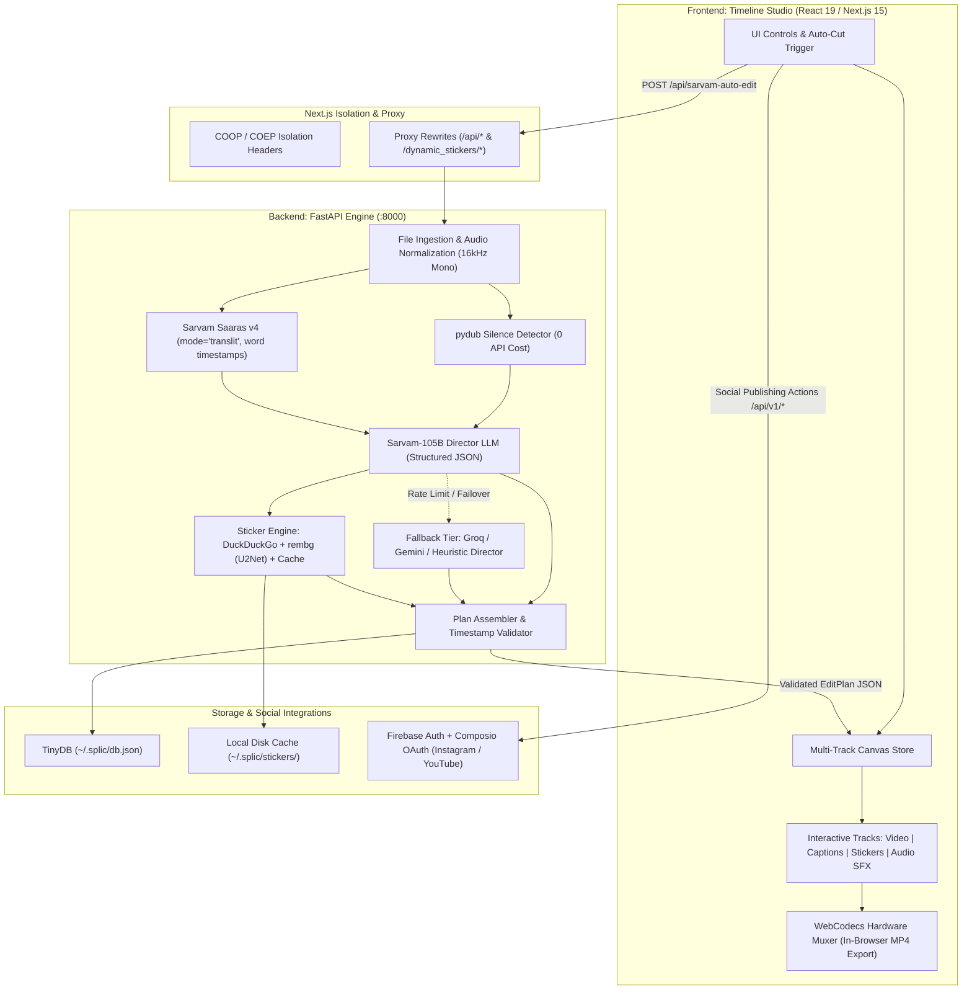
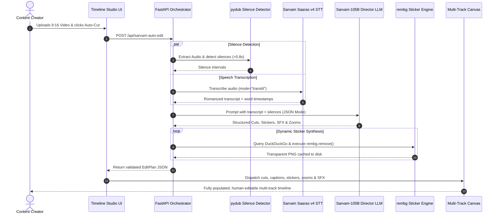

# Splic Studio

**Autonomous, Human-in-the-Loop Indic Short-Form Video Auto-Editor**

[](LICENSE)
[](https://nextjs.org/)
[](https://react.dev/)
[](https://fastapi.tiangolo.com/)
[](https://www.python.org/)
[](#system-architecture)
[](#ai-pipeline-specifications)

> Splic transforms raw 9:16 smartphone clips into polished vertical reels with **one-click AI Auto-Cut**, word-level **Romanized Indic karaoke captions**, vernacular silence/filler cuts, dynamic background-removed Indian cultural stickers, contextual meme sound effects, and punch-in zooms—all rendered onto a non-destructive, browser-native multi-track timeline with zero cloud render waiting.

---

## Table of Contents

- [Overview](#overview)
- [Key Features](#key-features)
- [System Architecture](#system-architecture)
- [Quick Start](#quick-start)
  - [Prerequisites](#prerequisites)
  - [1-Click Launch (Recommended)](#1-click-launch-recommended)
  - [Manual Setup](#manual-setup)
- [Configuration and Environment Variables](#configuration-and-environment-variables)
  - [Root `.env.local`](#root-envlocal)
  - [Backend `backend/.env`](#backend-backendenv)
- [AI Pipeline Specifications](#ai-pipeline-specifications)
  - [1. Audio Extraction and Silence Pre-Check](#1-audio-extraction-and-silence-pre-check)
  - [2. Speech-to-Text: Sarvam Saaras v4](#2-speech-to-text-sarvam-saaras-v4)
  - [3. AI Video Director: Sarvam-105B Conversations](#3-ai-video-director-sarvam-105b-conversations)
  - [4. Dynamic Sticker Synthesis and Background Removal](#4-dynamic-sticker-synthesis-and-background-removal)
  - [5. Resilient Fallback Strategies](#5-resilient-fallback-strategies)
- [API Reference](#api-reference)
  - [Auto-Cut and Core Service](#auto-cut-and-core-service)
  - [Stickers Catalog and Resolver](#stickers-catalog-and-resolver)
  - [Project Management (TinyDB)](#project-management-tinydb)
  - [Composio and Multi-Tenant Social Publishing (`/api/v1`)](#composio-and-multi-tenant-social-publishing-apiv1)
- [Frontend Multi-Track Timeline and Browser Isolation](#frontend-multi-track-timeline-and-browser-isolation)
  - [SharedArrayBuffer and Cross-Origin Isolation (COOP/COEP)](#sharedarraybuffer-and-cross-origin-isolation-coopcoep)
  - [WebCodecs In-Browser MP4 Export](#webcodecs-in-browser-mp4-export)
  - [UI Design and Iconography Constraints](#ui-design-and-iconography-constraints)
- [Repository Structure](#repository-structure)
- [Deploying to Vercel](#deploying-to-vercel)
- [Development, Testing and Verification](#development-testing-and-verification)
  - [Running Unit and Integration Tests](#running-unit-and-integration-tests)
  - [Pre-Commit / Pre-PR Verification Checklist](#pre-commit--pre-pr-verification-checklist)
- [Troubleshooting and FAQ](#troubleshooting-and-faq)
- [Documentation and Related Resources](#documentation-and-related-resources)
- [License](#license)

---

## Overview

Over 40 million Indian content creators publish short-form vertical videos (Instagram Reels, YouTube Shorts) in code-mixed vernaculars (*Hinglish, Tanglish, Kanglish*). Existing global AI video editors fail for Indic creators because they:

1. **Struggle with Rapid Vernaculars:** Traditional speech engines fail on code-mixed phrasing and heavy accent variations.
2. **Impose Unreadable Scripts:** Default models force formal Devanagari or regional Dravidian scripts instead of the **Romanized phonetic transliterations** (*"Aaj hum baat karenge..."*) that Gen-Z and modern social audiences read.
3. **Lack Cultural Knowledge:** Western tools have zero asset awareness for Indian cultural icons, brands, foods, and societal memes (*Zomato, Swiggy, UPI, Biryani, Auto-rickshaw, Chai, Jugaad*).
4. **Miss Vernacular Speech Patterns:** They overlook regional conversational hesitation fillers (*"matlab"*, *"arre"*, *"toh basically"*) and comedic meme timing.
5. **Black-Box Rendering:** Most web tools force creators to wait 10+ minutes for cloud video rendering, returning static MP4s that cannot be edited or adjusted when the AI makes a typo.

**Splic** bridges this gap by combining **Sarvam AI's Indic models** with **Timeline Studio's browser-native WebCodecs canvas editor**. In a single click, creators receive an editable, multi-track timeline populated with cuts, animated karaoke captions, transparent cultural stickers, and punchy sound effects—retaining 100% human creative control.

---

## Key Features

- **1-Click Auto-Cut Engine:** Ingests raw vertical video/audio (15–60s) and produces an interactive multi-track edit in seconds.
- **Synchronized Romanized Karaoke Captions:** Word-level timestamps transcribed via Sarvam Saaras v4 in phonetic Latin script, styled with active-word highlight animations and optional dual Hinglish + English translations.
- **Zero-Cost Local Silence and Ripple Cuts:** Detects pauses (> 0.8s) locally via `pydub` (zero API spend) and blends them with Sarvam-105B filler cuts. Ripple-delete algorithms preserve downstream track synchronization.
- **Dynamic Cultural Sticker Synthesis:** Discovers Indian cultural references, fetches high-resolution web imagery via DuckDuckGo, strips backgrounds locally using `rembg` (U2Net), caches transparent PNGs, and places them onto timeline overlay tracks.
- **Meme Sound Effects and Punch-In Zooms:** Contextual triggers (`vine_boom.mp3`, `cash.mp3`, `ding.mp3`, `record_scratch.mp3`) accompanied by programmatic `1.25x` camera zoom keyframes.
- **100% Human-in-the-Loop:** All AI decisions land as distinct, draggable clips on dedicated tracks (Video, Text Overlay, PiP Image, Audio SFX). Scrub, trim, nudge, and adjust anytime.
- **Client-Side WebCodecs Export:** Hardware-accelerated MP4 rendering directly in Chrome/Edge. Zero server rendering costs, zero queue waiting, and complete privacy for local files.
- **One-Click Social Publishing:** Integrated Firebase Auth and Composio OAuth service to connect Instagram Reels and YouTube Shorts channels directly from the studio.

---

## System Architecture



---

## Quick Start

### Prerequisites

- **Node.js:** `v20.x` or later (tested on Node 20–24) and `npm`
- **Python:** `3.10` to `3.13` (includes `venv` and `pip`)
- **FFmpeg:** System binary recommended in `PATH` (optional for local processing; browser bundle includes `@ffmpeg/ffmpeg` wasm fallback)
- **Sarvam AI API Key:** Required for live auto-cutting. Obtain an API key from the [Sarvam AI Dashboard](https://www.sarvam.ai/).

### 1-Click Launch (Recommended)

Splic provides native concurrency orchestrators for all major platforms. These scripts verify prerequisites, set up virtual environments, install dependencies, create default `.env` files, and launch both FastAPI and Next.js simultaneously:

**macOS & Linux:**
```bash
chmod +x run.sh
./run.sh
```

**Windows (PowerShell):**
```powershell
.\run.ps1
```

**Windows (Command Prompt / Double-Click):**
```cmd
run.bat
```

Once launched:
- **Timeline Studio Frontend:** [http://localhost:3000](http://localhost:3000)
- **FastAPI Backend Server:** [http://localhost:8000](http://localhost:8000)
- **Interactive Swagger Docs:** [http://localhost:8000/docs](http://localhost:8000/docs)
- **Graceful Shutdown:** Press `Ctrl+C` in the terminal to terminate all services cleanly.

---

### Manual Setup

If you prefer running services in separate terminal tabs:

#### 1. Backend Service (FastAPI)

```bash
# Navigate to the backend directory
cd backend

# Create and activate a Python virtual environment
python -m venv .venv

# On Linux/macOS:
source .venv/bin/activate
# On Windows (PowerShell):
.venv\Scripts\Activate.ps1
# On Windows (cmd.exe):
.venv\Scripts\activate.bat

# Install Python requirements
pip install -r requirements.txt

# Create your backend .env file
cp .env.example .env
# Edit backend/.env and add your SARVAM_API_KEY

# Start FastAPI development server
uvicorn main:app --reload --host 0.0.0.0 --port 8000
```

#### 2. Frontend Application (Timeline Studio)

```bash
# Navigate to timeline_studio from the project root
cd timeline_studio

# Install Node dependencies
npm install

# Start Next.js development server
npm run dev
```

Visit [http://localhost:3000](http://localhost:3000) in your browser.

---

## Configuration and Environment Variables

Splic utilizes a clean dual-configuration structure: root configuration for unified deployments and service-specific overrides.

### Root `.env.local`

Template available at [`.env.example`](.env.example):

```env
# Frontend Firebase Web SDK (Public Project Metadata)
NEXT_PUBLIC_FIREBASE_API_KEY=AIzaSyExampleFakeApiKeyForTemplateOnly
NEXT_PUBLIC_FIREBASE_AUTH_DOMAIN=splic-app.firebaseapp.com
NEXT_PUBLIC_FIREBASE_PROJECT_ID=splic-app
NEXT_PUBLIC_FIREBASE_STORAGE_BUCKET=splic-app.firebasestorage.app
NEXT_PUBLIC_FIREBASE_MESSAGING_SENDER_ID=123456789012
NEXT_PUBLIC_FIREBASE_APP_ID=1:123456789012:web:abcdef1234567890abcdef

# Backend Firebase Admin SDK (Private Authentication Verification)
FIREBASE_PROJECT_ID=splic-app
FIREBASE_SERVICE_ACCOUNT_JSON={"type":"service_account","project_id":"splic-app",...}
FIREBASE_CLOCK_SKEW_SECONDS=10

# Composio Integration (Social Media Publishing)
COMPOSIO_API_KEY=your_composio_api_key_here

# Networking & Service Hosts
HOST=0.0.0.0
PORT=8000
ENVIRONMENT=development
LOG_LEVEL=INFO
FRONTEND_URL=http://localhost:3000
BACKEND_URL=http://localhost:8000
OAUTH_REDIRECT_URL=http://localhost:3000/auth/callback
```

### Backend `backend/.env`

Template available at [`backend/.env.example`](backend/.env.example):

| Variable | Required | Default | Description |
|---|---|---|---|
| `SARVAM_API_KEY` | **Yes** | — | Primary subscription key for Saaras v4 STT and Sarvam-105B LLM. |
| `FALLBACK_PROVIDER` | No | `none` | Fallback director when Sarvam limits are reached: `none`, `groq`, or `gemini`. |
| `GROQ_API_KEY` | No | — | Required if `FALLBACK_PROVIDER=groq`. Uses `llama-3.3-70b-versatile`. |
| `GEMINI_API_KEY` | No | — | Required if `FALLBACK_PROVIDER=gemini`. Uses `gemini-2.0-flash`. |
| `SPLIC_DATA_DIR` | No | `~/.splic` | Local database, run traces, and dynamic stickers storage directory. |
| `PORT` | No | `8000` | Port for the FastAPI server. |

---

## AI Pipeline Specifications

The Splic automated pipeline executes across five deterministic stages:



### 1. Audio Extraction and Silence Pre-Check
- **Audio Extraction:** Ingested vertical videos (`.mp4`, `.mov`, `.webm`) are extracted to high-fidelity 16kHz mono audio via FFmpeg or `imageio-ffmpeg`.
- **Local Silence Detection:** `silence_detector.py` invokes `pydub.silence.detect_silence()` to spot speech pauses (> 0.8 seconds at -36 dBFS). This executes locally in ~50ms at zero API cost.

### 2. Speech-to-Text: Sarvam Saaras v4
- **Endpoint:** `POST https://api.sarvam.ai/speech-to-text`
- **Model:** `saaras:v4`
- **Mode:** `mode="translit"` *(Crucial: converts spoken Indic languages directly into Romanized Latin characters, producing subtitles that Indian viewers natively read).*
- **Language Support:** `hi-IN` (Hindi), `ta-IN` (Tamil), `te-IN` (Telugu), `kn-IN` (Kannada), `bn-IN` (Bengali), `gu-IN` (Gujarati), `mr-IN` (Marathi), or auto-detection.
- **Output:** Word-level timestamps (`start_time`, `end_time`, `word`) mapped onto the source clock.

### 3. AI Video Director: Sarvam-105B Conversations
- **Endpoint:** `https://api.sarvam.ai/v2/chat/completions`
- **Model:** `sarvam-105b` (128K context, native understanding of Indian pop culture, jokes, and colloquialisms).
- **Enforced JSON Output:** Evaluates the transcript against strict Pydantic schemas:
  - **Cuts:** Filler words (*"matlab"*, *"arre"*, *"basically"*, stuttering, false starts).
  - **Stickers:** Concrete cultural references (*"Zomato"*, *"Virat Kohli"*, *"Chai"*, *"UPI"*).
  - **SFX:** Audio emphasis triggers placed at punchlines or emotional beats.
  - **Zooms:** Programmatic `1.25x` camera punch-ins for emphasis.

```json
{
  "cuts": [
    { "start": 3.15, "end": 5.40, "reason": "Dead air hesitation" }
  ],
  "stickers": [
    {
      "keyword": "Zomato",
      "asset": "/api/stickers/zomato.png",
      "start": 1.25,
      "duration": 2.0,
      "position": { "x": 0.5, "y": 0.3 }
    }
  ],
  "sfx": [
    { "asset": "/assets/sound-effects/vine_boom.mp3", "start": 6.65, "volume": 0.8 }
  ],
  "zooms": [
    { "start": 6.65, "end": 7.30, "scale": 1.25 }
  ]
}
```

### 4. Dynamic Sticker Synthesis and Background Removal
- **Search:** Queries DuckDuckGo for transparent PNG assets matching the director's keywords with a 4-second safety timeout.
- **Background Removal:** Local execution of `rembg.remove()` using U2Net model weights (~300ms on CPU).
- **Disk Caching:** Processed assets are stored in `~/.splic/stickers/<slug>.png`. Repeat queries are served instantly from disk cache.
- **Fallbacks:** Curated pre-bundled assets in `timeline_studio/public/assets/stickers/` guarantee the pipeline never crashes if web search is throttled.

### 5. Resilient Fallback Strategies
If Sarvam AI's chat completion endpoints experience rate limits or network degradation:
1. **Tier 1:** Automated retry with backoff.
2. **Tier 2:** Provider failover to **Groq** (`llama-3.3-70b-versatile`) or **Google Gemini** (`gemini-2.0-flash`) if configured.
3. **Tier 3:** Offline **Heuristic Rule-Based Director** (`plan_builder.heuristic_director`), deriving cuts from local `pydub` silences and keyword dictionaries without requiring external cloud LLMs.

---

## API Reference

### Auto-Cut and Core Service

#### `GET /api/health`
Returns system status, active dependencies, rembg availability, and storage statistics.

#### `POST /api/sarvam-auto-edit`
The unified auto-edit orchestrator. Accepts an audio or video file upload and returns a validated `EditPlan` JSON payload.

**Parameters (Multipart Form-Data):**
- `file` (*UploadFile*, required): Video (`.mp4`, `.mov`, `.webm`) or Audio (`.wav`, `.mp3`, `.m4a`).
- `project_id` (*str*, optional): Identifier to associate results with a stored project.
- `language_code` (*str*, default: `"hi-IN"`): BCP-47 language tag.
- `caption_style` (*str*, default: `"romanized"`): `"romanized"` or `"dual"`.
- `fetch_stickers` (*bool*, default: `true`): Enables or disables dynamic web scraping.

---

### Stickers Catalog and Resolver

- `GET /api/stickers` — List all cataloged stickers stored in TinyDB.
- `GET /api/stickers/{filename}` — Serve a transparent sticker PNG with explicit `Cross-Origin-Resource-Policy: cross-origin` headers.
- `POST /api/stickers/scrape` — Trigger an on-demand scrape and rembg pass for a specific keyword.
- `POST /api/stickers/resolve` — Ingest a list of sticker requests and return resolved local URLs.

---

### Project Management (TinyDB)

Persisted locally at `~/.splic/db.json`:
- `GET /api/projects` — List stored projects.
- `POST /api/projects` — Create a new project workspace.
- `GET /api/projects/{project_id}` — Fetch project state and saved edit plans.
- `PATCH /api/projects/{project_id}` — Update timeline state and metadata.
- `DELETE /api/projects/{project_id}` — Remove project and associated run traces.

---

### Composio and Multi-Tenant Social Publishing (`/api/v1`)

Allows creators to connect social publishing accounts via OAuth authenticated through Firebase:
- `GET /api/v1/auth/health` — Check Firebase Admin SDK verification status.
- `GET /api/v1/connections` — List active social accounts for the authenticated Firebase user.
- `POST /api/v1/connections/{app_name}/initiate` — Initiate Composio OAuth for Instagram (`instagram`) or YouTube (`youtube`).
- `POST /api/v1/actions/execute` — Dispatch an automated publishing action (e.g., upload reel).

---

## Frontend Multi-Track Timeline and Browser Isolation

### SharedArrayBuffer and Cross-Origin Isolation (COOP/COEP)

Timeline Studio executes in-browser WebCodecs muxing, SIMD-accelerated ONNX runtimes, and WebWorkers. Modern browsers mandate **Cross-Origin Isolation** for `SharedArrayBuffer` access.

`timeline_studio/next.config.mjs` enforces the required security headers:
```http
Cross-Origin-Opener-Policy: same-origin
Cross-Origin-Embedder-Policy: require-corp
Cross-Origin-Resource-Policy: same-origin
```

To prevent the browser from blocking backend sticker PNGs and audio assets under `COEP: require-corp`:
1. Next.js proxies `/api/*` and `/dynamic_stickers/*` directly to `http://localhost:8000`.
2. The FastAPI backend sends `Cross-Origin-Resource-Policy: cross-origin` on all asset responses.

### WebCodecs In-Browser MP4 Export

Video compilation executes directly within the client's browser hardware via `@libav.js/variant-webcodecs` and `@mediabunny/aac-encoder`:
- **Hardware Accelerated:** Uses the user's local GPU/CPU hardware encoder.
- **Zero Server Rendering Costs:** The backend server never handles video encoding or large MP4 file generation.
- **Privacy First:** User videos never leave the creator's machine unless explicitly dispatched to the auto-cut transcription pipeline.

### UI Design and Iconography Constraints

- **Strict Lucide React Iconography:** All UI icons are imported exclusively from `lucide-react` (with `strokeWidth={1.25}`).
- **Zero UI Emojis:** Per project engineering guidelines, emojis are forbidden within UI chrome, buttons, headers, and toolbars (emojis are permitted only within final video text overlays/captions).

---

## Repository Structure

```text
.
├── backend/                       # Python FastAPI backend and AI pipelines
│   ├── composio/                  # Social publishing integration and Firebase Auth
│   │   ├── app/                   # FastAPI sub-application for Composio OAuth
│   │   └── tests/                 # Unit and live integration test suite
│   ├── db/                        # Database access layer (TinyDB)
│   ├── scraper/                   # DuckDuckGo search + rembg background removal
│   ├── audio_utils.py             # Audio extraction and FFmpeg validation
│   ├── catalog.py                 # Curated Indian sticker and SFX catalog
│   ├── config.py                  # Storage directories (~/.splic) and environment
│   ├── main.py                    # Root FastAPI application and route registration
│   ├── plan_builder.py            # EditPlan assembly, captioning and heuristic director
│   ├── sarvam_client.py           # Sarvam Saaras v4 STT and Sarvam-105B Director
│   ├── schemas.py                 # Pydantic data models (Cuts, Captions, SFX, Plan)
│   ├── silence_detector.py        # Local pydub silence interval detection
│   └── test_suite.py              # Pytest test suite with stubbed Sarvam boundaries
├── timeline_studio/               # Next.js 15 and React 19 Frontend Video Studio
│   ├── public/                    # Static assets and FFmpeg WebAssembly workers
│   │   └── assets/                # Curated fallback stickers and sound effects
│   ├── scripts/                   # Development utilities and CLI dispatchers
│   ├── src/                       # Application source code
│   │   ├── app/                   # Next.js App Router entrypoints
│   │   ├── components/            # Timeline, Topbar, Canvas and Inspector UI
│   │   ├── lib/                   # WebCodecs encoder, audio and video utilities
│   │   └── styles/                # Tailwind CSS and Splic theme definitions
│   └── next.config.mjs            # COOP/COEP isolation and backend proxy rewrites
├── docs/                          # Architecture audits and technical specifications
├── .env.example                   # Unified root environment template
├── AGENTS.md                      # Agentic instructions, guardrails and boundaries
├── GEMINI.md                      # Engineering guide and API contracts
├── indic_video_auto_editor_spec.md# Full technical product specification
├── run.sh                         # Concurrency runner for macOS / Linux
├── run.ps1                        # Concurrency runner for Windows PowerShell
├── run.bat                        # Concurrency runner for Windows Command Prompt
└── README.md                      # Primary project documentation
```

---

## Deploying to Vercel

The repo deploys as **one Vercel project** using [Vercel Services](https://vercel.com/docs/services) (Beta, all plans). The root `vercel.json` defines two services on one domain:

| Service | Root | Runtime | Receives |
| :--- | :--- | :--- | :--- |
| `web` | `timeline_studio/` | Next.js | everything except `/api/*` |
| `backend` | `backend/` | FastAPI (`main:app`) as a Python Vercel Function, `maxDuration: 300` | `/api/*` (full path, prefix not stripped) |

Because both services share one origin, stickers and API responses stay same-origin under COEP `require-corp`. No proxy is needed in production (the `localhost:8000` rewrite in `next.config.mjs` is disabled when `VERCEL` is set).

### Steps

1. Push the repo to GitHub, then on Vercel choose **Add New > Project** and import it. Leave **Root Directory** as the repository root (`./`). Vercel reads `vercel.json` and builds both services.
2. Under **Settings > Environment Variables**, add:
   - `SARVAM_API_KEY` (required; Auto-Cut returns 503 without it)
   - optional: `FALLBACK_PROVIDER` (`groq` | `gemini` | `none`), `GROQ_API_KEY`, `GEMINI_API_KEY`, `SARVAM_LLM_MODEL`, `STICKER_FETCH`
   - Composio/Firebase (`/api/v1`), if used: `COMPOSIO_API_KEY`, `FIREBASE_PROJECT_ID`, `FIREBASE_SERVICE_ACCOUNT_JSON`, `FRONTEND_URL`, `OAUTH_REDIRECT_URL` (set these to your Vercel domain)
   - `NEXT_PUBLIC_FIREBASE_*` for the frontend, if used
3. Deploy. Check `https://<your-domain>/api/health`.

CLI alternative: `npm i -g vercel`, then `vercel` (preview) or `vercel --prod` from the repo root. `.vercelignore` keeps `node_modules`, `.venv` and local env files out of the upload. `vercel dev` runs both services locally.

### Serverless behaviour to know about

- **Upload size:** Vercel Functions accept request bodies up to **4.5 MB**. Auto-Cut extracts the clip's audio in the browser (mono Opus, 32 kbps, about 18 minutes per 4.5 MB) and uploads only that. If the browser cannot encode Opus, it sends the original file, and anything over 4.5 MB fails with a 413.
- **Duration:** a run (Sarvam STT + director LLM + sticker scraping) must finish within `maxDuration` (300 s, the Hobby maximum). On Pro you can raise `maxDuration` in `vercel.json` up to 800.
- **Storage is ephemeral:** the backend writes TinyDB (`db.json`), scraped stickers and run logs to `/tmp/splic` on Vercel. That data lives only as long as the function instance, so projects saved through `/api/projects` do not persist across cold starts. Sticker PNGs are served with long CDN cache headers. If a request reaches an instance without the file, the backend scrapes the sticker again from its keyword. For persistent projects, move `backend/db` to a hosted database.
- **Studio catalogue snapshot:** the backend bundle does not contain `timeline_studio/`, so it reads the sticker manifest and SFX ids from `backend/studio_catalog/`. After adding or removing bundled stickers or sound effects, run `python backend/scripts/sync_studio_catalog.py` (the test suite fails while the snapshot is stale).
- **Python version:** `backend/.python-version` pins 3.12 (Vercel's default).

---

## Development, Testing and Verification

### Running Unit and Integration Tests

#### 1. Backend Pytest Suite

> [!IMPORTANT]
> The automated test suite **never consumes live Sarvam API credits**. All HTTP network boundaries are cleanly stubbed with pytest fixtures.

```bash
cd backend
# Run full backend test suite
python -m pytest test_suite.py -v

# Run Composio and Firebase verification tests
python -m pytest composio/tests -v
```

#### 2. Frontend Typecheck and Production Build

```bash
cd timeline_studio
# Validate TypeScript typings
npm run typecheck

# Validate Next.js production build
npm run build
```

---

### Pre-Commit / Pre-PR Verification Checklist

Before submitting code or finalizing features, verify:

- [ ] **TypeScript Build:** `cd timeline_studio && npm run build` completes with zero errors.
- [ ] **Backend Tests:** `python -m pytest backend/test_suite.py` passes completely.
- [ ] **Asset CORP Compliance:** Dynamic sticker images load in the browser canvas without `ERR_BLOCKED_BY_RESPONSE.NotSameOriginAfterDefaultedToSameOriginByCoep`.
- [ ] **Timeline Track Synchronization:** Captions, stickers, and sound effects appear on separate draggable tracks and maintain sync with spoken dialogue.
- [ ] **WebCodecs MP4 Export:** Exporting a processed reel renders a valid, playable `.mp4` file containing burned-in karaoke subtitles, stickers, and audio tracks.
- [ ] **Zero UI Emojis:** No emojis present in UI buttons, titles, or alerts (use `lucide-react` icons).

---

## Troubleshooting and FAQ

### 1. `ERR_BLOCKED_BY_RESPONSE` on dynamic stickers or SFX
- **Cause:** Browser Cross-Origin Embedder Policy (`require-corp`) blocked an asset lacking CORP headers.
- **Solution:** Access assets through the Next.js rewrite proxy (`/api/stickers/...`) or verify that the backend is responding with `Cross-Origin-Resource-Policy: cross-origin`.

### 2. Auto-Cut returns `503 Service Unavailable`
- **Cause:** `SARVAM_API_KEY` is missing or invalid in `backend/.env`.
- **Solution:** Add a valid subscription key to `backend/.env` and restart the FastAPI server. If you lack an active key for local debugging, configure `FALLBACK_PROVIDER=gemini` or `FALLBACK_PROVIDER=groq`.

### 3. Audio extraction fails on uploaded video
- **Cause:** System is missing FFmpeg and `imageio-ffmpeg` wheel could not decode the container.
- **Solution:** Install FFmpeg on your host machine (`brew install ffmpeg` on macOS, `sudo apt install ffmpeg` on Ubuntu, or `winget install Gyan.FFmpeg` on Windows) and ensure `ffmpeg` is available in your system `PATH`.

### 4. `EPERM: operation not permitted` on Windows npm install
- **Cause:** Temporary file lock by Windows Defender or terminal sandbox.
- **Solution:** Re-run `npm install` in an elevated terminal prompt.

---

## Documentation and Related Resources

- [AGENTS.md](AGENTS.md) — Coding agent rules, architecture boundaries, and verification workflows.
- [GEMINI.md](GEMINI.md) — Detailed technical specifications, Indic transliteration design, and API contracts.
- [indic_video_auto_editor_spec.md](indic_video_auto_editor_spec.md) — Comprehensive functional and product specification.
- [Firebase Migration Audit](docs/FIREBASE_MIGRATION_AUDIT.md) — Architecture audit of the Firebase authentication migration.
- [Project Structure Audit](docs/PROJECT_STRUCTURE_AUDIT.md) — In-depth breakdown of repository decoupling and storage paths.

---

## License

This project is licensed under the **MIT License**. See the [LICENSE](LICENSE) file for details.
